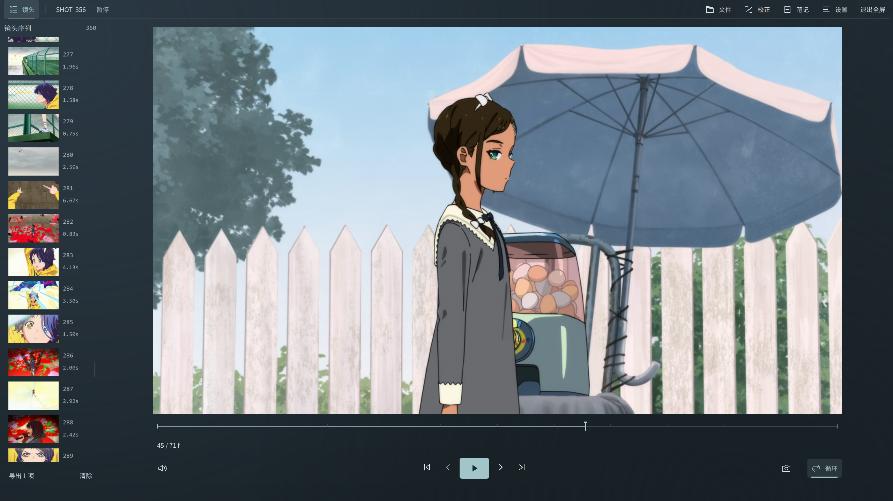
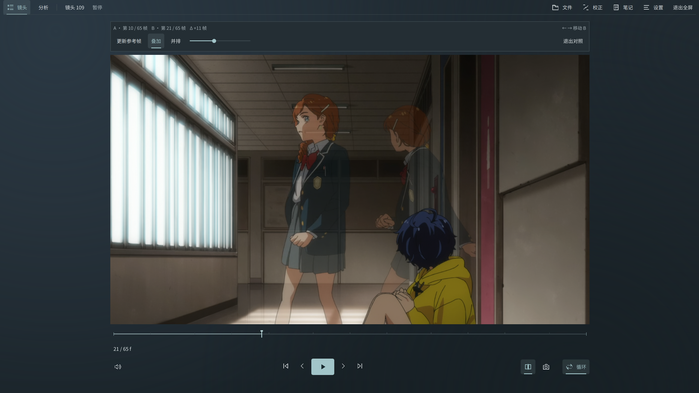
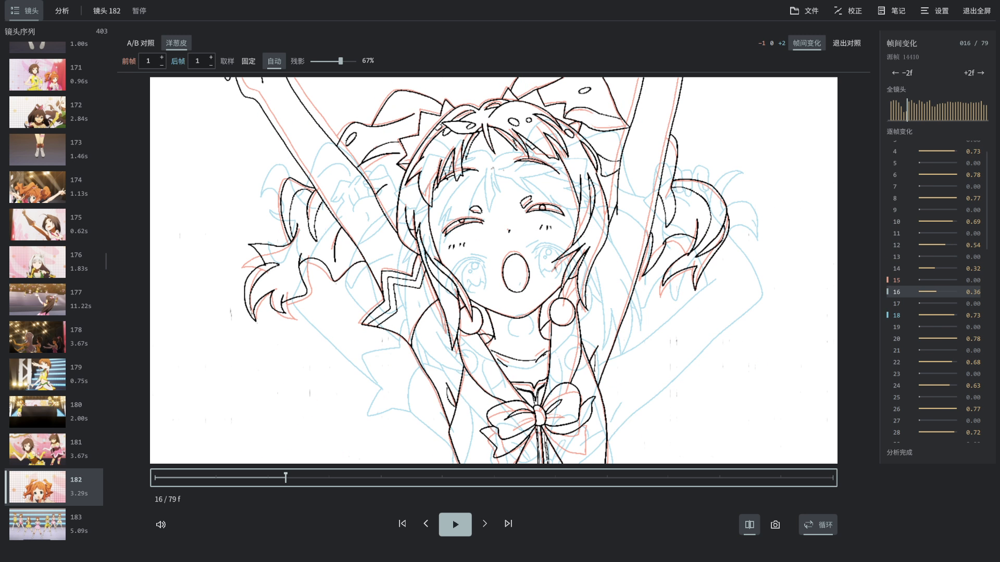
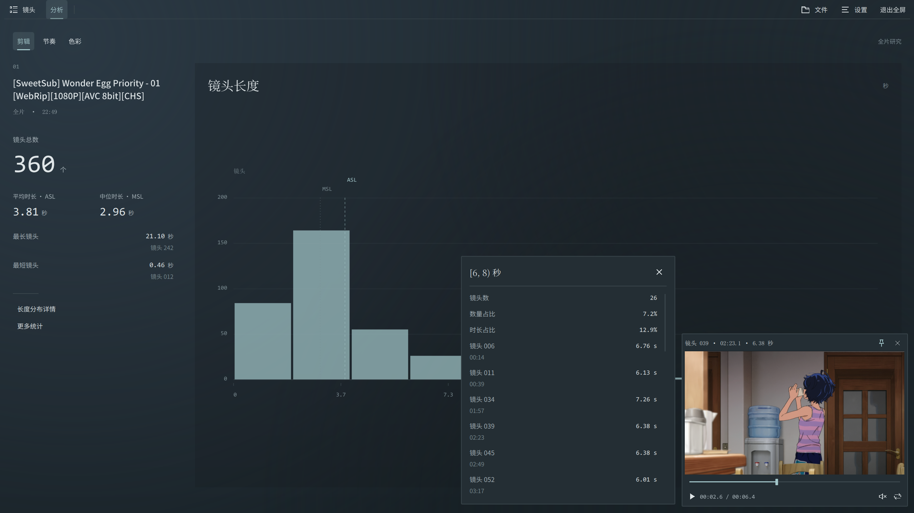
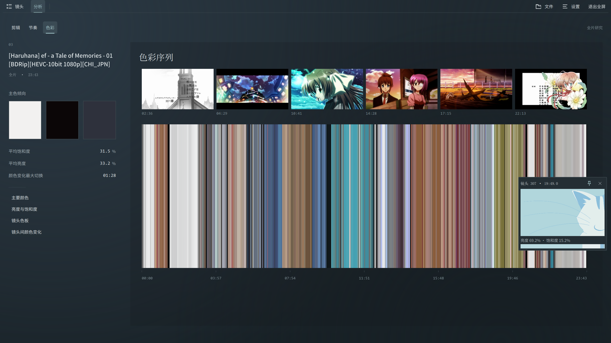
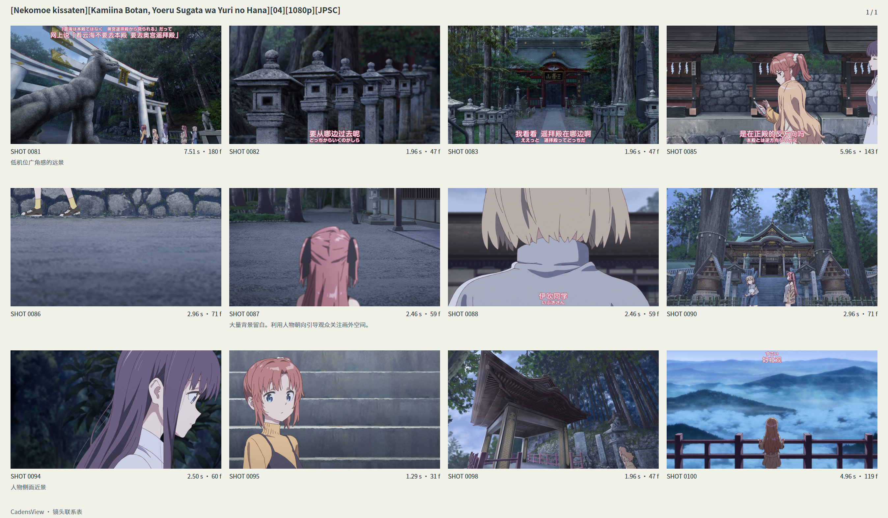

# CadensView

**一个用于动画镜头观察与分析的桌面工具。**

CadensView 是一款面向动画爱好者、作画研究者与影像创作者的免费桌面工具，致力于让普通观众向着动画高手迈进。

它可以在正常观看视频的同时，将一部动画整理成独立的镜头序列，方便用户逐帧观看、反复比较画面、调整切点与记录笔记。暂停时还可以把画面转为线稿，叠加前后帧观察动作。同时提供剪辑节奏和色彩分析功能，支持导出分镜表 PDF、动画分析长图、联系表、GIF、镜头数据表格等多种形式，帮助用户从单个镜头和整部作品两个尺度观察影像。

支持 Windows 与 Apple Silicon macOS，所有视频处理与项目数据均保存在本地。

当前核心源码对应 CadensView 0.3.1，版本变化见 [CHANGELOG](CHANGELOG.md#v031--2026-11-14)。可下载的版本以 GitHub Releases 为准。

## 功能介绍

### 1. 镜头浏览与自动切分

将视频导入 CadensView 后，软件会在后台建立帧索引并自动检测镜头切换位置，将完整视频整理成连续的镜头列表。

- 通过缩略图浏览整部动画的镜头序列。
- 快速跳转到指定镜头，查看对应画面。
- 查看镜头编号、持续时间等基本信息。
- 检测尚未完成时，也可以先开始播放视频。

镜头列表与中央播放器保持关联，便于在整体结构和具体画面之间切换。

### 2. 逐帧观察与画面对照

对于需要仔细观察的镜头，可以使用逐帧浏览、局部循环和画面比较功能。

- 按源视频帧逐帧前进或后退。
- 循环播放选定镜头或短区间。
- 放大、平移画面，观察局部细节。
- 使用 A/B 帧对照，比较同一镜头内或不同镜头中的两个画面。
- 通过并排或叠加模式观察构图、动作和画面变化。

这些功能适合反复观察动画动作、镜头构图、摄影效果，以及一些容易在正常播放中忽略的细节。

### 3. 线稿洋葱皮

在画面对照中切换到「洋葱皮」，暂停时画面会转为线稿，并把前后帧的线稿叠在当前帧上。当前帧为黑色，前帧为暖色，后帧为青色。

- 分别设置叠加的前帧、后帧数量。
- 取样可以按固定间隔，也可以自动跳过停帧，找到最近的不同姿态。
- 调节残影强度，突出当前帧或参考帧。
- 右侧「帧间变化」面板显示整个镜头和附近逐帧的线稿变化量，点击即可跳到对应的帧。
- 开始播放时回到原视频，暂停后恢复线稿。

### 4. 镜头编辑与笔记

自动检测的结果可以根据自己的观察进行调整。

- 手动拆分或合并镜头。
- 调整相邻镜头之间的切点。
- 为镜头添加文字笔记。
- 按 K 把当前帧设为镜头的代表帧，用于分镜表和代表图。
- 撤销、重做编辑操作。
- 保存项目并在下次打开时继续之前的工作。

CadensView 不会直接修改原始视频。镜头信息、人工校正和笔记作为独立项目保存在本地。

### 5. 剪辑、节奏与色彩分析

除了观察单个镜头，CadensView 也提供三个专题分析工作区，用于了解一部作品在时间和视觉上的整体特征。

#### 剪辑

从镜头数量、持续时间及长度分布等角度观察作品的剪辑结构。

例如，可以查看短镜头与长镜头的分布情况，找到持续时间较长的段落，或者了解整部作品的平均镜头长度。镜头长度分布可以切换为对数横轴，让长短镜头在同一张图中比较。

#### 节奏

观察镜头长度如何随影片时间发生变化，以及不同段落的切镜密度和节奏差异。

通过时间分布图，可以直观地看到某个段落的镜头变化是否更加密集，或者哪些部分使用了较长时间的连续镜头。

#### 色彩

提取视频中的色彩特征，从时间轴、镜头色板等角度观察作品的视觉变化。

可以查看不同镜头的代表色、整体色彩分布，以及相邻镜头之间的色彩差异。

#### 分析区间

一部作品里常有片头、片尾，或者想单独研究的某一片段。在「管理区间」中可以把这些段落标出来，再决定统计哪一部分。

- 按镜头或按帧设定区间的起止位置，也可以直接在镜头列表中选择。
- 为区间命名，标注为片头、片尾或自定义，并设置颜色。
- 统计范围可以选择全片，或排除片头片尾。
- 选择若干区间组成自定义方案，命名保存后随时切换。

#### 从统计结果回到画面

分析工作区中的图表和详情与原视频关联。

用户可以通过悬停或点击相关条目预览对应镜头，在观察统计结果的同时，直接回到实际画面。

### 6. 导出与整理

CadensView 支持将观察和分析结果保存为不同格式，方便后续整理、分享或继续研究。

- **图片：** 导出源帧截图或镜头代表图。
- **动态画面：** 导出 GIF 或 MP4 片段。
- **联系表：** 将多个镜头整理成图片或 PDF。
- **分镜表：** 将选中的镜头整理成 A4 分镜表 PDF。
- **笔记：** 导出 Markdown 或 CSV。
- **数据：** 导出 CSV、JSON 等结构化信息。

导出功能可以与镜头选择配合使用，将需要的画面或数据集中整理。

## 下载与使用

### 系统要求

- Windows x64，或 Apple Silicon 的 macOS 14 及更新版本
- 支持 CPU 镜头检测
- Windows 可在兼容的设备上使用 DirectML GPU 加速；线稿洋葱皮在独立显存 6 GB 以上时自动使用显卡，仅用 CPU 时生成线稿较慢
- 无需另外安装 Python、PyTorch 或 CUDA Toolkit

### 下载

在 [GitHub Releases](https://github.com/dddkkw/CadensView/releases) 提供 Windows 安装版和便携版，以及 macOS 的 DMG 安装映像和便携包。

macOS 版本未经 Apple 公证，首次打开时可能被系统拦截，确认来源后可按系统提示选择「仍要打开」。

### 快速开始

1. 启动 CadensView，打开或拖入一个视频文件。
2. 在镜头列表中选择需要观察的镜头。
3. 使用逐帧、循环、画面对照、洋葱皮等功能进行观察。
4. 根据需要校正镜头边界、添加笔记。
5. 进入剪辑、节奏或色彩分析工作区，或者将内容导出为分镜表等格式。
6. 享受动画片本身吧！

## 本地处理与项目数据

CadensView 的视频分析与项目数据处理均在本地完成，不需要上传视频至在线服务。

原始视频不会因镜头拆分、笔记编辑或统计分析而被修改。

软件会在本地保存项目文件及必要的索引、缩略图和分析缓存。存储位置可以在设置中更改，已有数据会一并迁移。

源视频移动或改名后，可以重新链接到原项目。软件会先核对帧数和画面，确认是同一个视频后再继续使用。

## 语言

CadensView 提供以下界面语言：

- 简体中文
- English
- 日本語

## 已知限制

CadensView 仍处于早期版本，部分功能和设备兼容性有待继续完善。

- macOS 版本目前只支持 Apple Silicon，实际设备上的测试少于 Windows。
- 自动切镜结果可能存在误切或漏切，可以通过人工编辑进行调整。
- 线稿和帧间变化由模型估计。摄影移动、字幕和光效也会产生变化，变化量不等于原画张数。
- 部分编码格式、设备配置及特殊视频可能存在兼容性问题。
- 视频定位及短片段循环在某些情况下可能出现短暂停顿。

## 反馈与支持

如果遇到问题，或者有希望加入的功能，欢迎在 [GitHub Issues](https://github.com/dddkkw/CadensView/issues) 提交反馈。

CadensView 由个人开发和维护。如果软件对你有所帮助，也欢迎通过应用内的「支持项目」页面自愿赞助。

## 许可证与致谢

CadensView 已公开的自有核心代码采用 [MIT License](LICENSE)。

完整桌面应用目前公开了核心代码。第三方依赖与预训练模型遵循各自适用的许可证。

项目使用了 Qt / PySide6、FFmpeg / PyAV、ONNX Runtime、TransNet V2、AniLines 等开源技术。详细许可及归属信息以相应第三方声明为准。
